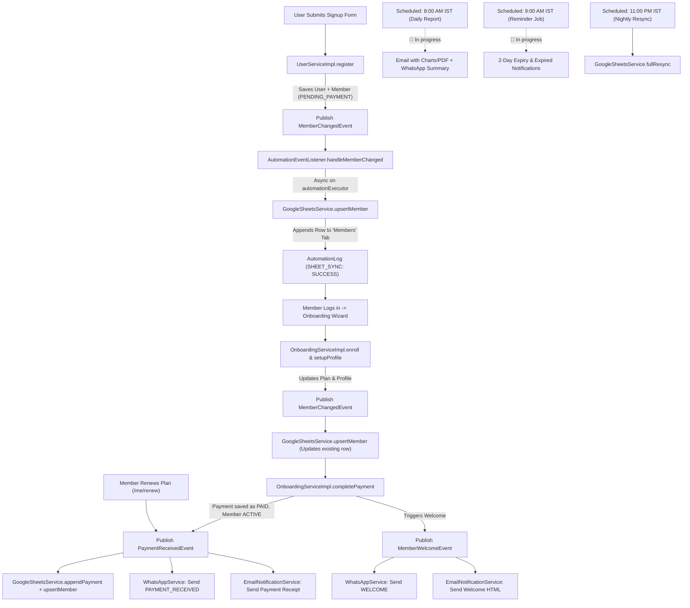

# 🏋️ BeastX Gym Management System

> **A full-stack enterprise gym management platform featuring role-based access control (RBAC), multi-step member onboarding, WebAuthn biometric passkey authentication, AI facial recognition attendance tracking, and asynchronous cloud automations with Google Sheets, Twilio WhatsApp/SMS, and Gmail SMTP.**

---

## 📑 Table of Contents
1. [Tech Stack & Architecture](#-tech-stack--architecture)
2. [User Roles & Permissions](#-user-roles--permissions)
3. [Features by Module](#-features-by-module)
4. [Project Directory Structure](#-project-directory-structure)
5. [Prerequisites](#-prerequisites)
6. [Step-by-Step Installation & Setup](#-step-by-step-installation--setup)
7. [Running the Application](#-running-the-application)
8. [End-to-End User Workflows](#-end-to-end-user-workflows)
9. [🤖 Automation Flow After a New Member Registers](#-automation-flow-after-a-new-member-registers)
10. [Third-Party Services Configuration](#-third-party-services-configuration)
11. [REST API Reference](#-rest-api-reference)
12. [Angular Frontend Routes](#-angular-frontend-routes)
13. [Troubleshooting Guide](#-troubleshooting-guide)
14. [Security & Secrets Hygiene](#-security--secrets-hygiene)
15. [Author & License](#-author--license)

---

## 🚀 Tech Stack & Architecture

| Layer | Technology | Version | Port / Default URL | Description |
| :--- | :--- | :--- | :--- | :--- |
| **Backend** | Spring Boot | `3.2.0` | `http://localhost:8080` | Core REST API, Security, Task Scheduling & Event Bus |
| **Language** | Java (JDK) | `17` | — | LTS Java Runtime with Records & Text Blocks |
| **Frontend** | Angular | `17.3.0` | `http://localhost:8081` | NgModule SPA, Dark & Orange Beast Theme |
| **Database** | MySQL Server | `9.7` / `8.0+` | `localhost:3306` | Relational storage (`gym_db`) via Spring Data JPA |
| **Authentication** | Spring Security + JJWT | `0.11.5` | — | Stateless JWT Bearer token authentication |
| **Biometrics / Passkey** | Yubico WebAuthn Core | `2.5.0` | — | FIDO2 / WebAuthn fingerprint & hardware passkey auth |
| **Facial AI** | vladmandic/face-api | `1.7.15` | — | In-browser face detection & 128-d descriptor recognition |
| **Spreadsheet Sync** | Google API Sheets | `v4-rev20230815-2.0.0` | — | Cloud sync via Service Account OAuth2 credentials |
| **Messaging** | Twilio Java SDK | `10.1.0` | — | Automated SMS & WhatsApp messaging |
| **Email** | Spring Boot Mail | `3.2.0` | `smtp.gmail.com:587` | JavaMailSender HTML transactional dispatch |
| **Reporting / Charts** | JFreeChart & OpenPDF | `1.5.4` / `1.3.39` | — | Automated chart generation & PDF daily snapshots |

---

## 👥 User Roles & Permissions

The BeastX platform enforces strict Role-Based Access Control (RBAC) via Spring Security `@PreAuthorize` annotations and Angular route guards (`authGuard`, `onboardingGuard`).

| Role | Scope | Allowed Actions & Views |
| :--- | :--- | :--- |
| **ADMIN** | System Owner | Full administrative oversight: Manage members, assign trainers, create/edit membership plans, review financial transactions, live webcam face-recognition check-in kiosk, manual attendance override, analytics dashboard, and automation audit logs. |
| **TRAINER** | Fitness Staff | View assigned members, track trainee membership status, log workout sessions, and mark personal attendance. |
| **MEMBER** | Gym Client | Self-registration, guided onboarding (Plan & Trainer selection, profile metrics, checkout), profile management, view active plan & days left, attendance history, payment history, face biometrics enrollment, and biometric passkey registration (Touch ID / Face ID / Windows Hello). |

---

## 📦 Features by Module

### 1. Authentication & Biometric Passkeys
* **JWT Authentication:** Stateless token-based login and signup with BCrypt password hashing.
* **FIDO2 / WebAuthn Biometric Passkeys:** Passwordless biometric login and check-in using Touch ID, Face ID, Android Biometrics, or Windows Hello powered by `com.yubico:webauthn-server-core`.
* **Credential Management:** Register multiple biometric devices per user, track sign counts, and revoke devices.

### 2. Multi-Step Member Onboarding
* **Interactive Guided Flow:** New members are automatically routed to a 5-step wizard (`/onboarding/plans` ➔ `/onboarding/trainer` ➔ `/onboarding/profile` ➔ `/onboarding/payment` ➔ `/onboarding/success`).
* **Profile Metrics:** Captures gender, date of birth, height (cm), weight (kg), calculated BMI, fitness goals, medical conditions, and emergency contact details.
* **Onboarding Route Guard:** Prevents members with incomplete onboarding from accessing dashboard modules until payment is finalized.

### 3. Member & Plan Management
* **Flexible Membership Plans:** Configurable plans with month durations, pricing, feature lists, and "Popular" tags.
* **Member Profiles:** View days remaining, renewal status, assigned trainer, and contact information.
* **Plan Upgrades & Renewals:** In-app renewals extending active validity periods seamlessly.

### 4. Trainer Management
* **Trainer Directory:** Specializations, bios, experience years, star ratings, and monthly personal training fees.
* **Assignment & Switching:** Members can select or change their assigned trainer anytime.

### 5. Payments & Financial Tracking
* **Payment Recording:** Multi-mode transactions (UPI, Card, Net Banking, Cash).
* **Automatic Invoicing:** Formatted invoice sequence generation (`INV-000001`).
* **Financial Rollups:** Monthly revenue tracking and member lifetime expenditure calculation.

### 6. Attendance & Face Recognition Check-In
* **Live Kiosk Face Scanner:** Continuous browser-based face detection on the Admin Dashboard using `@vladmandic/face-api` TinyFaceDetector models.
* **Facial Biometrics Enrollment:** Captures 3-sample 128-value facial descriptors, averages them, and stores the encrypted template.
* **Check-In Validation Engine:** Validates active membership plan, flags expiring memberships (<= 5 days), blocks expired plans, prevents duplicate check-ins on the same day, and automatically marks Trainer attendance.
* **Manual & QR Check-In:** Fallback options for administrative check-in overrides.

### 7. Cloud Automations
* **Google Sheets Real-Time Sync:** Auto-syncs members, payments, and daily stats to designated tabs (`Members`, `Payments`, `Daily Report`, `Charts`).
* **Twilio WhatsApp & SMS:** Transactional messaging with phone number normalization to E.164.
* **Gmail SMTP HTML Notifications:** Branded HTML notifications wrapped in a dark-theme responsive email container.
* **Expiry Reminders:** 🚧 *In progress (Phase 4)* - Daily scheduler for 2-day expiry warnings and expiry notifications.
* **Daily Report Engine:** 🚧 *In progress (Phase 5)* - 8:00 AM IST daily email summary with JFreeChart analytics and PDF report attachment.
* **Admin Automation Console:** 🚧 *In progress (Phase 6)* - Dedicated UI page for live configuration toggles, manual job triggers, and audit logs.

---

## 📂 Project Directory Structure

```text
Gym_Management/
├── angularapp/                  # Angular 17 SPA (Port 8081)
│   ├── src/
│   │   ├── app/
│   │   │   ├── components/     # Standalone & feature views (19 components)
│   │   │   ├── guards/         # authGuard, onboardingGuard
│   │   │   ├── interceptors/   # JwtInterceptor (Bearer token injection)
│   │   │   ├── models/         # TypeScript DTOs & data interfaces
│   │   │   ├── services/       # Angular Injectable HTTP API services
│   │   │   ├── app.module.ts   # Core NgModule declarations & imports
│   │   │   └── app-routing.module.ts # Client routing & role permissions
│   │   ├── assets/             # Images, styling assets & face-api models
│   │   └── index.html          # HTML entry point
│   ├── angular.json            # Workspace & dev-server build settings
│   └── package.json            # Node.js dependencies & scripts
├── springapp/                   # Spring Boot 3 Backend (Port 8080)
│   ├── src/main/java/com/gym/springapp/
│   │   ├── automation/         # Automations: Sheets, WhatsApp, Email & Events
│   │   │   ├── entity/         # AutomationLog, ReminderLog entities & enums
│   │   │   ├── events/         # MemberChangedEvent, PaymentReceivedEvent, MemberWelcomeEvent
│   │   │   └── repo/           # AutomationLogRepo, ReminderLogRepo
│   │   ├── config/             # SecurityConfig, JwtUtils, WebAuthnConfig, DataSeeder
│   │   ├── controller/         # 11 REST API Controllers
│   │   ├── dto/                # Request & Response Java Records
│   │   ├── exceptions/         # GlobalExceptionHandler & custom exceptions
│   │   ├── model/              # JPA Entities (User, Member, Plan, Trainer, Payment, Attendance, etc.)
│   │   ├── repository/         # Spring Data JPA Repositories
│   │   └── service/            # Business logic interfaces & implementations
│   ├── src/main/resources/
│   │   ├── application.properties          # Public application settings
│   │   ├── application-secrets.properties  # Secret tokens & credentials (git-ignored)
│   │   └── google-credentials.json         # Google Service Account private key (git-ignored)
│   └── pom.xml                 # Maven build dependencies & plugins
├── .gitignore                  # Git ignore rules (secrets & build outputs)
└── README.md                   # Complete system documentation
```

---

## 🛠️ Prerequisites

Ensure the following tools are installed on your machine. You can verify them in Windows PowerShell:

| Prerequisite | Minimum Version | PowerShell Check Command |
| :--- | :--- | :--- |
| **Java Development Kit (JDK)** | `17.x` | `java -version` |
| **Apache Maven** | `3.9.x` | `mvn -v` |
| **Node.js** | `18.x` or `20.x` | `node -v` |
| **npm** | `9.x` or `10.x` | `npm -v` |
| **Angular CLI** | `17.x` | `npx ng version` |
| **MySQL Server** | `8.0` or `9.x` | `& "C:\Program Files\MySQL\MySQL Server 9.7\bin\mysql.exe" -V` |
| **Git** | `2.x` | `git --version` |

---

## ⚙️ Step-by-Step Installation & Setup

### Step 1: Clone the Repository
```powershell
git clone https://github.com/Pavu02/Gym_Management.git
cd Gym_Management
```

### Step 2: Configure MySQL Database
Start your local MySQL service (via XAMPP or MySQL Server):
```powershell
# Verify MySQL connectivity
mysql -u root -p
```
Create the database if it doesn't exist:
```sql
CREATE DATABASE IF NOT EXISTS gym_db;
```

### Step 3: Configure Secrets (`application-secrets.properties`)
Create the file `springapp/src/main/resources/application-secrets.properties`. This file is ignored by Git to safeguard private keys.

Fill in your actual environment credentials:
```properties
# Database Credentials
spring.datasource.username=YOUR_DB_USER
spring.datasource.password=YOUR_DB_PASSWORD

# JWT Signing Secret Key
jwt.secret=YOUR_JWT_256_BIT_SECRET_KEY

# AES Encryption Key for Stored Biometrics
gym.biometric.aes-key=YOUR_AES_SECRET_KEY_16_OR_32_BYTES

# Seeded Default Admin Credentials
gym.admin.email=admin@gym.com
gym.admin.password=YOUR_ADMIN_PASSWORD

# Google Sheets Integration
automation.sheets.enabled=true
automation.sheets.spreadsheet-id=YOUR_GOOGLE_SPREADSHEET_ID
automation.sheets.credentials-file=google-credentials.json

# Twilio SMS & WhatsApp
automation.whatsapp.enabled=true
twilio.account-sid=YOUR_TWILIO_ACCOUNT_SID
twilio.auth-token=YOUR_TWILIO_AUTH_TOKEN
twilio.phone-number=YOUR_TWILIO_SMS_PHONE_NUMBER
twilio.whatsapp-from=whatsapp:+14155238886

# Gmail SMTP Configuration
automation.email.enabled=true
spring.mail.username=YOUR_GMAIL_ADDRESS@gmail.com
spring.mail.password=YOUR_GMAIL_16_CHAR_APP_PASSWORD

# Daily Report Notifications
automation.report.admin-emails=YOUR_ADMIN_EMAIL@gmail.com
automation.report.admin-phone=YOUR_ADMIN_MOBILE_NUMBER
```

### Step 4: Place Google Service Account Key
Save your Google Cloud Service Account JSON key as:
`springapp/src/main/resources/google-credentials.json`

### Step 5: Install Dependencies
Open a terminal in the project root:

**Backend (Spring Boot):**
```powershell
cd springapp
mvn clean install -DskipTests
cd ..
```

**Frontend (Angular):**
```powershell
cd angularapp
npm install
cd ..
```

---

## 🏃 Running the Application

### Option A: Running in Two Terminals

**Terminal 1 — Spring Boot Backend:**
```powershell
cd springapp
mvn spring-boot:run
```
* Backend starts at: `http://localhost:8080`

**Terminal 2 — Angular Frontend:**
```powershell
cd angularapp
npx ng serve --port 8081
```
* Frontend starts at: `http://localhost:8081`

### Option B: Stopping the Servers
* In either PowerShell terminal, press `Ctrl + C` and confirm with `Y`.
* To stop background instances running on the ports:
```powershell
# Stop process on port 8080
Stop-Process -Id (Get-NetTCPConnection -LocalPort 8080).OwningProcess -Force
# Stop process on port 8081
Stop-Process -Id (Get-NetTCPConnection -LocalPort 8081).OwningProcess -Force
```

---

## 🔄 End-to-End User Workflows

```
  MEMBER WORKFLOW                    ADMIN WORKFLOW                     TRAINER WORKFLOW
┌───────────────────────┐          ┌───────────────────────┐          ┌───────────────────────┐
│ Register at /signup   │          │ Login at /login       │          │ Login at /login       │
└──────────┬────────────┘          └──────────┬────────────┘          └──────────┬────────────┘
           ▼                                  ▼                                  ▼
┌───────────────────────┐          ┌───────────────────────┐          ┌───────────────────────┐
│ Guided Onboarding:    │          │ Admin Dashboard       │          │ Trainer Dashboard     │
│ Plans -> Trainer ->   │          │ Live Facial Kiosk     │          │ View Trainees & Info  │
│ Profile -> Payment    │          │ Members / Plans / Pay │          │ Check-in History      │
└──────────┬────────────┘          └──────────┬────────────┘          └───────────────────────┘
           ▼                                  ▼
┌───────────────────────┐          ┌───────────────────────┐
│ Member Dashboard:     │          │ Automation Console:   │
│ Face Biometrics       │          │ Audit Logs & Sync     │
│ WebAuthn Passkeys     │          │ Manual Job Triggers   │
│ Workouts & Attendance │          └───────────────────────┘
└───────────────────────┘
```

---

## 🤖 AUTOMATION FLOW AFTER A NEW MEMBER REGISTERS

### Real Code Execution Trace
All automations are decoupled from the main database transactions using Spring's `ApplicationEventPublisher` and executed asynchronously with `@TransactionalEventListener(phase = TransactionPhase.AFTER_COMMIT, fallbackExecution = true)` on the thread pool executor `automationExecutor`.



### Automation Execution Steps

| Step | Trigger | What Happens in Code | Channels | AutomationLog Type & Status | Status |
| :--- | :--- | :--- | :--- | :--- | :--- |
| **STEP 1: Registration** | POST `/api/auth/register` | `UserServiceImpl` saves `User` and `Member` with `PENDING_PAYMENT`. Publishes `MemberChangedEvent`. | Google Sheets | `SHEET_SYNC` ➔ `SUCCESS` | ✅ Implemented |
| **STEP 2: Profile & Plan Selection** | PUT `/api/onboarding/profile` | `OnboardingServiceImpl` updates profile metrics & trainer. Publishes `MemberChangedEvent`. | Google Sheets | `SHEET_SYNC` ➔ `SUCCESS` | ✅ Implemented |
| **STEP 3: Onboarding Checkout** | POST `/api/onboarding/payment` | `Payment` saved as `PAID`. Member activated with calculated `expiryDate`. Publishes `PaymentReceivedEvent` & `MemberWelcomeEvent`. | Google Sheets, Email, WhatsApp | `SHEET_SYNC`, `EMAIL`, `WHATSAPP` ➔ `SUCCESS` | ✅ Implemented |
| **STEP 4: Daily Analytics (8:00 AM IST)** | `@Scheduled` (Cron: `0 0 8 * * *`) | Computes daily statistics, generates JFreeChart graphics, compiles PDF summary, and emails admin with WhatsApp brief. | Email, WhatsApp, Google Sheets | `DAILY_REPORT` ➔ `SUCCESS` | 🚧 In progress |
| **STEP 5: Expiry Reminders (9:00 AM IST)** | `@Scheduled` (Cron: `0 0 9 * * *`) | Scans memberships expiring in 2 days and expired today. Checks `ReminderLog` to prevent duplicates. | Email, WhatsApp | `REMINDER` ➔ `SUCCESS` | 🚧 In progress |
| **STEP 6: Nightly Reconciliation (11:00 PM IST)** | `@Scheduled` (Cron: `0 0 23 * * *`) | `GoogleSheetsService.fullResync()` clears rows 2+ and rewrites all non-deleted members idempotently. | Google Sheets | `SHEET_SYNC` ➔ `SUCCESS` | ✅ Implemented |
| **STEP 7: Membership Renewal** | POST `/api/members/me/renew` | `MemberServiceImpl.renewMembership` creates new `Payment`, extends expiry date, and publishes `PaymentReceivedEvent`. | Google Sheets, Email, WhatsApp | `SHEET_SYNC`, `EMAIL`, `WHATSAPP` ➔ `SUCCESS` | ✅ Implemented |

---

### Notification Message Templates
Templates dynamically inject `automation.brand-name` from configuration:

| Template Identifier | Plain-Text Format (WhatsApp / SMS) | Styled HTML Layout (Email) |
| :--- | :--- | :--- |
| **WELCOME** | `Hi <name>, welcome to BeastX Gym! 💪 Your <plan> membership is active till <expiry>.` | Dark theme container with `#ff6b00` heading, badge with plan duration, expiry date, and workout tips. |
| **PAYMENT_RECEIVED** | `Hi <name>, we received ₹<amount> via <mode>. Membership valid till <expiry>. Thank you! 🙏` | Payment receipt with invoice number, transaction breakdown table, green payment badge, and validity date. |
| **EXPIRY_2_DAYS** | `Hi <name>, your BeastX Gym <plan> membership expires in 2 days (<expiry>). Renew now to keep training without a break! 🏋️` | Urgent reminder card with orange alert border, days left counter, and 1-click renewal instructions. |
| **EXPIRED** | `Hi <name>, your BeastX Gym membership expired on <expiry>. Visit the gym or renew from the app.` | Red status alert card informing of facility suspension and link to reactivate account. |

---

### Core Automation Safety Rules
1. **Never Break User Transactions:** All Sheets, WhatsApp, and Email calls run inside `@Async("automationExecutor")` wrapped with rigorous `try/catch`. A member registration or payment **always succeeds**, even if Google, Twilio, or Gmail is unreachable.
2. **Missing Contacts Handling:** If a member lacks a phone number, WhatsApp is logged as `SKIPPED` while Email is dispatched. If email is missing, Email is logged as `SKIPPED`.
3. **Graceful Degradation:** If credentials contain `PASTE_` placeholders or `enabled=false`, the action is skipped cleanly with message `"Automation disabled or not configured"`.
4. **Audit Trail:** Every action records an immutable audit entry in the MySQL `automation_logs` table (`id`, `type`, `target`, `status`, `message`, `createdAt`).

---

### How to Test the Automation Flow
1. **Sign Up:** Navigate to `http://localhost:8081/signup` and register a new account.
2. **Verify Sheet Row:** Open your Google Sheet `Members` tab; verify that the member appears with `Status = PENDING_PAYMENT`.
3. **Complete Onboarding:** Complete the wizard and finalize checkout at `/onboarding/payment`.
4. **Verify Live Updates:**
   * Google Sheet: The member's row status turns green `ACTIVE`, with calculated `Expiry Date` and `Total Paid`.
   * `Payments` Tab: A new row is appended with `Payment ID`, `Amount`, and `Invoice No`.
   * Email / WhatsApp: Instant welcome and payment confirmation notifications are received.
   * MySQL Logs: Run `SELECT * FROM automation_logs ORDER BY id DESC;` to view real-time execution entries.

---

## 🔑 Third-Party Services Configuration

### 1. Google Sheets API (Service Account)
1. Go to [Google Cloud Console](https://console.cloud.google.com/).
2. Create a Project and enable the **Google Sheets API**.
3. Create a **Service Account** under **IAM & Admin** > **Service Accounts**.
4. Create a JSON Key, download it, and rename it to `google-credentials.json`.
5. Place `google-credentials.json` in `springapp/src/main/resources/`.
6. Open your Google Sheet, click **Share**, and grant `Editor` access to the Service Account email (e.g., `gym-bot@project.iam.gserviceaccount.com`).
7. Copy the Spreadsheet ID from the URL (`https://docs.google.com/spreadsheets/d/<SPREADSHEET_ID>/edit`) into `automation.sheets.spreadsheet-id`.

### 2. Twilio WhatsApp Sandbox
1. Register at [Twilio](https://www.twilio.com/) and open the **Twilio Console**.
2. Copy your **Account SID** and **Auth Token** into `application-secrets.properties`.
3. Go to **Messaging** > **Try it out** > **Send a WhatsApp message**.
4. Join the sandbox by sending the activation phrase (e.g., `join <sandbox-code>`) to `+1 415 523 8886` from your test phone.

### 3. Gmail SMTP Setup
1. Log in to your Google Account and go to **Security**.
2. Enable **2-Step Verification**.
3. Search for **App Passwords**.
4. Generate a new App Password for "Mail" / "Custom (BeastX Gym)".
5. Copy the 16-character password into `spring.mail.password`.

---

## 📡 REST API Reference

### 🔐 Authentication (`/api/auth`)
| Method | Endpoint | Allowed Role | Description |
| :--- | :--- | :--- | :--- |
| `POST` | `/api/auth/register` | Public | Register new user account with `Role.MEMBER` |
| `POST` | `/api/auth/login` | Public | Authenticate credentials and receive Bearer JWT |

### 🚀 Onboarding (`/api/onboarding`)
| Method | Endpoint | Allowed Role | Description |
| :--- | :--- | :--- | :--- |
| `GET` | `/api/onboarding/status` | `MEMBER` | Check current user's onboarding completion status |
| `GET` | `/api/onboarding/plans` | `MEMBER` | Get available membership plans sorted by price |
| `GET` | `/api/onboarding/trainers` | `MEMBER` | Get list of available personal trainers |
| `POST` | `/api/onboarding/enroll` | `MEMBER` | Select plan and optional trainer |
| `PUT` | `/api/onboarding/profile` | `MEMBER` | Submit physical stats & emergency contacts |
| `GET` | `/api/onboarding/summary` | `MEMBER` | Calculate checkout fees and plan overview |
| `POST` | `/api/onboarding/payment` | `MEMBER` | Process onboarding payment and activate membership |

### 👤 Members (`/api/members`)
| Method | Endpoint | Allowed Role | Description |
| :--- | :--- | :--- | :--- |
| `GET` | `/api/members` | `ADMIN` | Retrieve all active gym members |
| `GET` | `/api/members/{id}` | `ADMIN` | Retrieve detailed member record by ID |
| `POST` | `/api/members` | `ADMIN` | Manually register a member profile |
| `PUT` | `/api/members/{id}` | `ADMIN` | Update member details and assigned plan |
| `DELETE`| `/api/members/{id}` | `ADMIN` | Soft-delete member profile |
| `PUT` | `/api/members/{id}/assign-trainer/{trainerId}` | `ADMIN` | Assign or re-assign personal trainer |
| `GET` | `/api/members/me` | `MEMBER` | View logged-in member's profile |
| `PUT` | `/api/members/me/profile` | `MEMBER` | Update personal physical stats |
| `PUT` | `/api/members/me/trainer/{id}` | `MEMBER` | Select or update personal trainer |
| `PUT` | `/api/members/me/trainer/remove` | `MEMBER` | Remove personal trainer |
| `POST` | `/api/members/me/renew` | `MEMBER` | Renew active or expired membership plan |

### 🏋️ Plans (`/api/plans`)
| Method | Endpoint | Allowed Role | Description |
| :--- | :--- | :--- | :--- |
| `GET` | `/api/plans` | Public | List all active gym membership plans |
| `GET` | `/api/plans/{id}` | Public | Get details of a specific plan |
| `POST` | `/api/plans` | `ADMIN` | Create a new membership plan |
| `PUT` | `/api/plans/{id}` | `ADMIN` | Update an existing membership plan |
| `DELETE`| `/api/plans/{id}` | `ADMIN` | Delete a membership plan |

### 🥋 Trainers (`/api/trainers`)
| Method | Endpoint | Allowed Role | Description |
| :--- | :--- | :--- | :--- |
| `GET` | `/api/trainers` | `ADMIN` | Retrieve all trainers |
| `GET` | `/api/trainers/{id}` | `ADMIN` | Get specific trainer profile |
| `POST` | `/api/trainers` | `ADMIN` | Create trainer profile and user account |
| `PUT` | `/api/trainers/{id}` | `ADMIN` | Update trainer bio, fees, and rating |
| `DELETE`| `/api/trainers/{id}` | `ADMIN` | Delete trainer record |
| `GET` | `/api/trainers/my-members` | `TRAINER` | View trainees assigned to logged-in trainer |

### 💳 Payments (`/api/payments`)
| Method | Endpoint | Allowed Role | Description |
| :--- | :--- | :--- | :--- |
| `POST` | `/api/payments` | `ADMIN` | Record payment manually |
| `GET` | `/api/payments` | `ADMIN` | List all system transactions |
| `GET` | `/api/payments/member/{memberId}` | `ADMIN` | Retrieve payments of a specific member |
| `GET` | `/api/payments/me` | `MEMBER` | View payment history of logged-in member |
| `DELETE`| `/api/payments/{id}` | `ADMIN` | Remove payment record |

### 📸 Face Recognition & Attendance (`/api/attendance` & `/api/face`)
| Method | Endpoint | Allowed Role | Description |
| :--- | :--- | :--- | :--- |
| `POST` | `/api/face/enroll/{userId}` | `ADMIN`, `MEMBER`, `TRAINER` | Enroll 128-value facial descriptor template |
| `GET` | `/api/face/descriptors` | `ADMIN` | Fetch all enrolled descriptors for live matcher |
| `DELETE`| `/api/face/{userId}` | `ADMIN` | Clear face descriptor data |
| `POST` | `/api/attendance/face-checkin` | `ADMIN` | Automatic check-in via live facial recognition |
| `POST` | `/api/attendance/manual-checkin/{userId}`| `ADMIN` | Manual check-in override |
| `GET` | `/api/attendance/today` | `ADMIN` | Live check-in list for current date |
| `GET` | `/api/attendance/all` | `ADMIN` | Filtered attendance logs |
| `GET` | `/api/attendance/my` | `MEMBER`, `TRAINER` | Personal attendance logs |
| `POST` | `/api/attendance/me/check-in` | `MEMBER` | Self check-in |
| `POST` | `/api/attendance/me/check-out` | `MEMBER` | Self check-out |

### 🔑 WebAuthn Biometric Passkeys (`/api/member/passkey` & `/api/checkin/passkey`)
| Method | Endpoint | Allowed Role | Description |
| :--- | :--- | :--- | :--- |
| `POST` | `/api/member/passkey/register/options` | `MEMBER`, `ADMIN` | Request WebAuthn device registration challenge |
| `POST` | `/api/member/passkey/register/verify` | `MEMBER`, `ADMIN` | Verify and store public key credential |
| `GET` | `/api/member/passkey/devices` | `MEMBER`, `ADMIN` | List registered passkey devices |
| `DELETE`| `/api/member/passkey/{credentialId}` | `MEMBER`, `ADMIN` | Delete a registered passkey |
| `POST` | `/api/checkin/passkey/options` | Public | Request assertion challenge for check-in |
| `POST` | `/api/checkin/passkey/verify` | Public | Verify fingerprint passkey check-in |

### 📊 Dashboard & Analytics (`/api/dashboard`)
| Method | Endpoint | Allowed Role | Description |
| :--- | :--- | :--- | :--- |
| `GET` | `/api/dashboard/stats` | `ADMIN` | Retrieve aggregated member, attendance, and revenue KPIs |

---

## 🌐 Angular Frontend Routes

All client routes are configured in `angularapp/src/app/app-routing.module.ts`:

| Route Path | Component | Guard(s) | Allowed Role | Description |
| :--- | :--- | :--- | :--- | :--- |
| `/home` | `HomeComponent` | None | Public | Landing page with gym highlights & plans |
| `/login` | `LoginComponent` | None | Public | Login form with standard & passkey authentication |
| `/signup` | `SignupComponent` | None | Public | New member registration form |
| `/onboarding/plans` | `OnboardingplansComponent` | `authGuard`, `onboardingGuard` | `MEMBER` | Step 1: Select membership plan |
| `/onboarding/trainer`| `OnboardingtrainerComponent`| `authGuard`, `onboardingGuard` | `MEMBER` | Step 2: Choose personal trainer |
| `/onboarding/profile`| `OnboardingprofileComponent`| `authGuard`, `onboardingGuard` | `MEMBER` | Step 3: Enter physical metrics & contact |
| `/onboarding/payment`| `OnboardingpaymentComponent`| `authGuard`, `onboardingGuard` | `MEMBER` | Step 4: Checkout & payment confirmation |
| `/onboarding/success`| `OnboardingsuccessComponent`| `authGuard`, `onboardingGuard` | `MEMBER` | Step 5: Onboarding completion summary |
| `/admin/dashboard` | `AdmindashboardComponent` | `authGuard` | `ADMIN` | Admin KPI metrics & live face check-in kiosk |
| `/admin/plans` | `AdminviewplansComponent` | `authGuard` | `ADMIN` | Plan management table |
| `/admin/plans/add` | `AdminaddplanComponent` | `authGuard` | `ADMIN` | Create membership plan form |
| `/admin/plans/edit/:id` | `AdminaddplanComponent` | `authGuard` | `ADMIN` | Edit existing plan |
| `/admin/members` | `AdminviewmembersComponent` | `authGuard` | `ADMIN` | Member directory & trainer assignment |
| `/admin/members/add` | `AdminaddmemberComponent` | `authGuard` | `ADMIN` | Add member manually |
| `/admin/members/edit/:id` | `AdminaddmemberComponent` | `authGuard` | `ADMIN` | Edit member details |
| `/admin/trainers` | `AdminviewtrainersComponent` | `authGuard` | `ADMIN` | Trainer directory |
| `/admin/trainers/add`| `AdminaddtrainerComponent` | `authGuard` | `ADMIN` | Add new trainer |
| `/admin/trainers/edit/:id`| `AdminaddtrainerComponent` | `authGuard` | `ADMIN` | Edit trainer details |
| `/admin/payments` | `AdminviewpaymentsComponent`| `authGuard` | `ADMIN` | Financial transactions audit view |
| `/admin/attendance`| `AdminviewattendanceComponent`| `authGuard`| `ADMIN` | Filtered attendance logs & history |
| `/member/profile` | `MemberprofileComponent` | `authGuard`, `onboardingGuard` | `MEMBER` | Member profile, face biometrics & passkeys |
| `/member/plan` | `MemberviewplanComponent` | `authGuard`, `onboardingGuard` | `MEMBER` | Current plan status, days left & renewal |
| `/member/trainer` | `MembertrainerComponent` | `authGuard`, `onboardingGuard` | `MEMBER` | Trainer info & change trainer request |
| `/member/attendance`| `MemberattendanceComponent`| `authGuard`, `onboardingGuard`| `MEMBER` | Personal workout check-in & logs |
| `/member/payments` | `MemberpaymentsComponent` | `authGuard`, `onboardingGuard` | `MEMBER` | Personal invoice and receipt history |
| `/trainer/members` | `TrainerviewmembersComponent` | `authGuard` | `TRAINER` | Trainees assigned to logged-in trainer |
| `**` | `ErrorComponent` | None | Public | 404 / 403 Fallback error view |

---

## 🔧 Troubleshooting Guide

| Issue / Error | Root Cause | Resolution |
| :--- | :--- | :--- |
| `mvn` or `npm` is not recognized | Build tools not present in system `PATH` | Install Apache Maven and Node.js, and append their `bin` directories to your Windows Environment `PATH`. |
| `Can't connect to MySQL server on 'localhost:3306'` | MySQL Server service is stopped | Start MySQL via XAMPP Control Panel or run `mysqld.exe --console`. |
| `Access denied for user 'root'@'localhost'` | Database password mismatch | Verify `spring.datasource.password` in `application-secrets.properties` matches your MySQL root password. |
| `Port 8080 or 8081 already in use` | Zombie background task or another server running | Find and kill the process: `Stop-Process -Id (Get-NetTCPConnection -LocalPort 8080).OwningProcess -Force`. |
| `CORS Error: No 'Access-Control-Allow-Origin' header` | Origin mismatch in CORS configuration | Verify `SecurityConfig.java` has `.cors(Customizer.withDefaults())` and frontend calls `http://localhost:8080`. |
| `401 Unauthorized` / `403 Forbidden` | Expired JWT token or missing role authority | Re-authenticate via `/login`. Ensure token is sent in the `Authorization: Bearer <TOKEN>` header. |
| `535-5.7.8 Username and Password not accepted` | Standard Gmail password used instead of App Password | Enable 2-Step Verification on Google and generate a dedicated 16-character **App Password** for `spring.mail.password`. |
| `WhatsApp Sandbox Not Joined` | Recipient mobile has not joined Twilio Sandbox | Send `join <sandbox-code>` to `+1 415 523 8886` from the destination phone before testing messages. |
| `Twilio: Cannot send to unverified number` | Twilio trial account restriction | Verify recipient numbers in the Twilio Console under **Verified Caller IDs**. |
| `Google Sheets 403: The caller does not have permission` | Sheet not shared with Service Account | Open the Google Sheet, click **Share**, and grant `Editor` permissions to the client email found inside `google-credentials.json`. |
| `GitHub push blocked (GH013: secret detected)` | Secrets committed to Git history | Ensure `application-secrets.properties` and `google-credentials.json` are listed in `.gitignore` before committing. |

---

## 🛡️ Security & Secrets Hygiene

1. **Git Protection:** Sensitive configuration files (`application-secrets.properties`, `google-credentials.json`, `application-local.properties`) are strictly ignored in `.gitignore`. **Never remove them from `.gitignore`.**
2. **Default Password Rotation:** The initial administrator account (`admin@gym.com` / `admin123`) is seeded automatically via `DataSeeder.java`. Change this password immediately upon first production deployment.
3. **Biometric Security:** Facial descriptors and WebAuthn public key credentials are encrypted with AES-256 before database persistence. No raw images or biometric representations leave the client browser.
4. **Key Rotation:** Periodically rotate your `jwt.secret`, `gym.biometric.aes-key`, Twilio Auth Token, and Gmail App Password.

---

## 👨‍💻 Author & License

* **Author:** Pavan Rajesh Gosavi
* **GitHub:** [@Pavu02](https://github.com/Pavu02)
* **Project Repository:** [BeastX Gym Management System](https://github.com/Pavu02/Gym_Management)

*Crafted with passion for athletic excellence and high-performance engineering.* 🏋️‍♂️🔥


